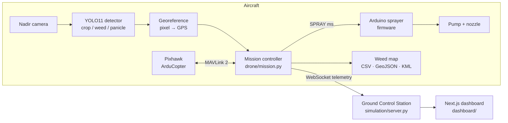

<div align="center">

# 🌱 AgriDrone AI
### Autonomous Weed Detection & Precision Spot-Spraying Drone

An autonomous drone surveys a crop field and finds every weed with a **YOLO11** vision model.
It pins each weed to a **GPS coordinate** and sprays herbicide **only where it is needed**.


</div>

---

## Table of contents

1. [Overview](#overview)
2. [Key results](#key-results)
3. [Features](#features)
4. [How it works](#how-it-works)
5. [Getting started](#getting-started)
6. [Running the project](#running-the-project)
7. [Website & dashboard](#website--dashboard)
8. [AI model & training](#ai-model--training)
9. [Hardware](#hardware)
10. [Configuration](#configuration)
11. [Project structure](#project-structure)
12. [Testing](#testing)
13. [Troubleshooting](#troubleshooting)
14. [Acknowledgements](#acknowledgements)

---

## Overview

Conventional farming sprays herbicide over the whole field, even though weeds cover only a small fraction
of it. This project builds an autonomous drone system that sprays the weed, not the field:

1. **Survey:** the drone flies a lawn-mower path and photographs the field from 10 m.
2. **Detect:** YOLO11 runs onboard and labels every plant as `crop` or `weed`. With the TiHAN-trained model it also labels rice `panicle`.
3. **Georeference:** every detection is converted from pixels to metres to **latitude / longitude**.
4. **Spot-spray:** weeds are clustered, crops are protected by a safety margin, and the drone descends and sprays each cluster.
5. **Report:** the drone returns home, lands, and exports a GPS **weed map** (CSV / GeoJSON / KML) for the farmer.

> **Hardware-ready, demonstrated in simulation.** The full aircraft stack is in this repository:
> - Pixhawk MAVLink driver, Raspberry Pi camera driver, Arduino sprayer firmware
> - wiring tables, bill of materials, ArduPilot parameters, Pi setup script and boot service
>
> Every hardware interface has a simulated twin, so the **exact same mission code** runs in the web
> simulator, in ArduPilot SITL, and on the real drone.

## Key results

Reference mission over the 1,200 m² demo field (simulator + real YOLO11 model):

| Metric | Result |
|---|---|
| Weeds detected and geo-tagged | **93** |
| Crop plants protected | **12** (one weed was skipped because it was too close to a crop) |
| Herbicide used | **1.29 L** spot spraying vs **36 L** blanket spraying |
| Chemical saved | **96.4 %** |
| AI inference | **~110 ms** per photo (laptop CPU) |
| Mission time | **~5 min**: takeoff, 12 photos, 86 spray shots, return and land |

## Features

- 🧠 **YOLO11 detection:** crop / weed (+ rice panicle), exportable to NCNN, ONNX or TensorRT for edge devices.
- 📍 **Georeferencing:** pixel → ground → GPS using altitude, camera FOV and heading.
- 🗺️ **Coverage path planning:** boustrophedon survey for any field polygon, with export to Mission Planner / QGroundControl.
- 💧 **Precision spraying:** crop-safety filter, weed clustering, nearest-neighbour routing, tank tracking.
- 🛡️ **Three layers of failsafes:**
  - companion computer: battery, geofence, altitude, operator abort, pilot override
  - Pixhawk: battery, RC loss, GCS loss, EKF, fence
  - sprayer firmware: link watchdog, RC kill switch, maximum spray time, empty tank
- 🛰️ **Web Ground Control Station:** live map, onboard camera with detections, telemetry and mission control over WebSockets.
- 🌐 **Next.js website & dashboard:** animated project landing page, live detection, batch analytics, flight logs and GPS weed maps.
- 🔁 **One code base, three run modes:** `sim`, `sitl` (real ArduCopter firmware) and `hardware`.
- 📼 **Offline demo:** the simulator page replays a recorded mission even without Python installed.

---

## How it works



**Mission sequence** ([`drone/mission.py`](drone/mission.py)):

| Phase | What happens |
|---|---|
| **Plan** | Lawn-mower survey over the field polygon from the camera footprint and overlap ([`mission_planner.py`](drone/mission_planner.py)) |
| **Preflight** | GPS 3D fix, battery, sprayer link, AI model, geofence |
| **Takeoff** | GUIDED mode, climb to the 10 m survey altitude |
| **Survey** | Fly to each photo point, capture, run YOLO11, georeference ([`geo.py`](drone/geo.py)) |
| **Spray** | Drop weeds within 15 cm of a crop, cluster within 0.6 m, descend to 3 m, pulse the pump 600 ms per cluster |
| **RTL** | Return to launch, land, disarm; export the weed map and mission report |

### One code base, three run modes

| Component | `sim` (web demo) | `sitl` | `hardware` |
|---|---|---|---|
| Flight controller | `SimFlightController` (kinematic model) | ArduPilot SITL via MAVLink | Pixhawk via MAVLink |
| Camera | `SimCamera` (real field images laid out as tiles) | `SimCamera` | `PiCamera2Camera` / `OpenCVCamera` |
| Sprayer | `SimSprayer` (virtual tank) | `SimSprayer` | `SerialSprayer` (Arduino) / `GpioSprayer` / `MavlinkSprayer` |
| AI, planning, georeferencing, mission, weed map | **identical** | **identical** | **identical** |

---

## Getting started

### Prerequisites

| Tool | Version | Needed for |
|---|---|---|
| [Python](https://www.python.org/downloads/) | 3.10 – 3.12 | AI model, simulator, onboard software |
| [Node.js](https://nodejs.org/) | 20 or newer | Next.js website & dashboard (optional) |
| Git | any | cloning the repository |

### Installation

```bash
git clone https://github.com/arpandey1405/AI-Weed-Detection.git
cd AI-Weed-Detection
```

**Python backend**

```bash
python -m venv .venv
# Windows
.venv\Scripts\activate
# Linux / macOS
source .venv/bin/activate

pip install -r requirements.txt
```

**Website & dashboard** (optional)

```bash
npm --prefix dashboard install
```

The trained model `models/best.pt` is included in the repository. No extra download is needed.

---

## Running the project

### One click (Windows)

| File | Opens |
|---|---|
| **`run_dashboard.bat`** | The full website at **http://localhost:3000** (landing page + dashboard). It also starts the AI backend. |
| **`run_demo.bat`** | The simulator / Ground Control Station only, at **http://localhost:8000** |

### Manual (any OS, two terminals)

```bash
# terminal 1 - AI backend + simulator (wait for "Ground Control Station ready")
python simulation/server.py

# terminal 2 - website & dashboard
npm --prefix dashboard run dev
```

Open **http://localhost:3000** → *Open dashboard* → **Live simulator** → **Start mission**.

### No Python on the presentation PC?

Open `simulation/web/index.html` directly in a browser. It replays a mission recorded from the real simulator.

### All commands

| Command | What it does |
|---|---|
| `python simulation/server.py` | AI backend + web Ground Control Station + live simulation (port 8000) |
| `npm --prefix dashboard run dev` | Next.js landing page + analysis dashboard (port 3000) |
| `python -m drone.main --mode sim` | Fly a full mission in the console, no browser |
| `python -m drone.main --mode sitl` | Fly against ArduPilot SITL (real ArduCopter firmware) |
| `python -m drone.main --mode hardware` | On the Raspberry Pi: fly the real drone |
| `python -m drone.main --export-plan logs/mission.waypoints` | Export the survey for Mission Planner / QGroundControl |
| `python src/batch_detect.py` | Detect on every image in `drone_data/images` → `results/` |
| `python src/test_model.py` | Detect on `test_images/field.jpg` |
| `python simulation/record_demo.py` | Re-record the offline replay |
| `python dashboard/scripts/build_showcase.py` | Refresh the real AI examples on the landing page |
| `streamlit run app.py` | Lightweight Streamlit dashboard (fallback) |
| `python -m unittest discover tests -v` | Run the test suite |

---

## Website & dashboard

A professional web front end built with Next.js, TypeScript, Tailwind CSS, Framer Motion and Recharts
([`dashboard/`](dashboard)).

| Page | Description |
|---|---|
| `/` **Landing page** | Animated drone survey, how-it-works pipeline, real YOLO11 detections, animated hardware diagram, impact statistics, run modes |
| `/dashboard` **Overview** | System status, model information, latest mission KPIs |
| `/dashboard/detect` **Detect** | Upload or pick an image; live YOLO11 with confidence and altitude controls, hover details, CSV export |
| `/dashboard/batch` **Batch report** | Detections per image, confidence distribution, annotated gallery |
| `/dashboard/flights` **Flight logs** | Mission reports and the georeferenced GPS weed map (GeoJSON / CSV export) |
| `/dashboard/simulator` **Live simulator** | The Ground Control Station, embedded |

The landing page works on its own. The dashboard pages talk to the Python backend through a `/backend/*`
proxy, and they show a clear message if the backend is not running. Details: [`dashboard/README.md`](dashboard/README.md).

**Ground Control Station** ([`simulation/`](simulation)): a FastAPI server streams the live mission over WebSockets. Its page shows:
- the map with the field imagery, planned and flown paths, weeds, crops and spray events
- the onboard camera view with detection boxes
- telemetry, battery and tank levels
- mission controls: start, pause, abort and simulation speed

On a real flight the Raspberry Pi streams to `ws://<laptop>:8000/ws/drone`, and the same page becomes the live ground station.

---

## AI model & training

| | |
|---|---|
| **Architecture** | YOLO11s (Ultralytics), 640 × 640 input |
| **Current model** | `models/best.pt`, classes `crop`, `weed` |
| **Merged model (notebook)** | classes `crop`, `weed`, `panicle` |
| **Edge export** | `python hardware/export_model.py --format ncnn` (Raspberry Pi) or `--format engine` (Jetson) |

### Datasets

| Dataset | Annotation | Used as |
|---|---|---|
| [Weed-Crop Aerial](https://huggingface.co/datasets/Francesco/weed-crop-aerial) (HuggingFace) | COCO bounding boxes | `crop` (0), `weed` (1) |
| **TiHAN Paddy** (`Paddy_Dataset.zip`, 1,919 images, 62.5k labels) | **Point** annotations: one `x y` pixel per rice **panicle** | `panicle` (2) |

The TiHAN labels mark rice panicles (grain heads), not weeds. The notebook does three things with them:
1. turns each point into a box
2. adds the boxes as a separate `panicle` class
3. splits train/val by source photo, so patches of one image never leak between splits

`panicle` is listed under `crop_classes` in the config, so the drone never sprays it.

### Retrain on Google Colab

1. Upload `Paddy_Dataset.zip` to Google Drive at `MyDrive/datasets/Paddy_Dataset.zip`.
2. Open [`notebooks/weed_detection_training_merged.ipynb`](notebooks/weed_detection_training_merged.ipynb) in Colab.
   Choose **Runtime → T4 GPU**, then **Run all**.
3. The notebook:
   - checkpoints to Drive, so a disconnect is recoverable with `RESUME = True`
   - evaluates each dataset separately and against the previous model
   - downloads `best_merged.pt`
4. Copy it to `models/best.pt`, then refresh the results:
   ```bash
   python src/batch_detect.py
   python dashboard/scripts/build_showcase.py
   python simulation/record_demo.py
   ```

---

## Hardware

| Subsystem | Components |
|---|---|
| Airframe | F450 quad, 4 × 920 KV motors, 30 A ESCs, 4S 5200 mAh LiPo |
| Flight | Pixhawk 2.4.8 / 6C running ArduCopter 4.5, M8N/M10 GPS + compass, RC receiver, SiK telemetry |
| Companion AI | Raspberry Pi 5 (8 GB) with the Pi Camera on a gimbal; alternative: Jetson Orin Nano |
| Sprayer | Arduino Nano, IRLZ44N MOSFET, 12 V pump, YF-S201 flow sensor, float switch, 2 L tank |
| Estimated cost | **≈ ₹ 57,000** |

[`hardware/README.md`](hardware/README.md) covers:
- the full bill of materials, wiring tables and pin maps
- the build and bring-up procedure
- the two-person flight procedure
- ArduPilot SITL instructions

Hardware files:

| File | Purpose |
|---|---|
| [`hardware/ardupilot_params.param`](hardware/ardupilot_params.param) | Pixhawk parameters: companion link, failsafes, geofence, relay |
| [`hardware/setup_raspberry_pi.sh`](hardware/setup_raspberry_pi.sh) | One-shot Raspberry Pi setup (UART, camera, venv, NCNN export, service) |
| [`hardware/weed-drone.service`](hardware/weed-drone.service) | systemd service: starts at boot, waits for the pilot to select GUIDED |
| [`hardware/check_hardware.py`](hardware/check_hardware.py) | Bench test of every component (props off!) |
| [`firmware/sprayer_controller/sprayer_controller.ino`](firmware/sprayer_controller/sprayer_controller.ino) | Arduino pump controller with watchdog and failsafes |

> Follow the DGCA Drone Rules 2021 for real flights: Digital Sky registration, green zones, visual line of sight,
> and PPE when handling agrochemicals. Test with water.

---

## Configuration

Everything is controlled by [`configs/drone_config.yaml`](configs/drone_config.yaml):

```yaml
mode: sim                         # sim | sitl | hardware

detector:
  model_path: models/best.pt      # models/best_ncnn_model on the Raspberry Pi
  confidence: 0.25
  weed_classes: [weed]
  crop_classes: [crop, panicle]   # never sprayed

mission:
  home: {lat: 22.975, lon: 88.434}        # replace with your field
  survey_altitude_m: 10
  spray_altitude_m: 3
  strategy: detect_and_spray              # or survey_only
  field_polygon_latlon: []                # [[lat, lon], ...] of the field corners

safety:
  rtl_battery_pct: 25
  geofence_margin_m: 8
  max_altitude_m: 30
```

---

## Project structure

```
AI-Weed-Detection/
├── configs/drone_config.yaml     all settings: mode, model, camera, sprayer, mission, safety
├── models/best.pt                trained YOLO11 weights
├── drone/                        ONBOARD SOFTWARE (runs on the Raspberry Pi)
│   ├── main.py                   entry point, builds the drivers for sim / sitl / hardware
│   ├── mission.py                autonomous detect-and-spray state machine + failsafes
│   ├── flight_controller.py      MAVLink (Pixhawk / SITL) + simulated flight controller
│   ├── camera.py                 Picamera2 / USB / simulated camera
│   ├── sprayer.py                Arduino serial / GPIO / Pixhawk relay / simulated sprayer
│   ├── detector.py               YOLO11 wrapper (PyTorch, NCNN, ONNX, TensorRT)
│   ├── geo.py                    GPS ↔ metres, camera footprint, pixel → ground
│   ├── mission_planner.py        coverage path planning, .waypoints export
│   ├── weed_map.py               de-duplicated geo-referenced weed map (CSV / GeoJSON / KML)
│   ├── telemetry.py              JSONL black-box log, WebSocket link to the GCS
│   ├── sim_world.py              virtual field built from drone_data/images
│   └── clock.py                  real / accelerated simulation time
├── simulation/
│   ├── server.py                 FastAPI: AI API, live simulator, hardware telemetry ingest
│   ├── record_demo.py            records the offline replay
│   └── web/                      Ground Control Station page (+ data/demo_recording.js)
├── dashboard/                    Next.js landing page + analysis dashboard
├── firmware/sprayer_controller/  Arduino Nano pump controller
├── hardware/                     BOM, wiring, ArduPilot params, Pi setup, systemd, bench test
├── notebooks/                    Colab training notebook (HuggingFace + TiHAN Paddy)
├── src/                          detection scripts (single image, batch)
├── drone_data/                   drone imagery used as the simulated field + image geotags
├── test_images/                  sample image for src/test_model.py
├── tests/                        unit + integration tests
├── docs/DEMO_GUIDE.md            step-by-step presentation script + faculty Q&A
├── app.py                        Streamlit dashboard (fallback)
├── run_dashboard.bat             one click: backend + website
├── run_demo.bat                  one click: simulator only
└── requirements.txt
```

Folders created at run time, which are git-ignored: `logs/` (flight logs and weed maps), `results/` (batch
detection output) and `runs/` (training runs).

---

## Testing

```bash
python -m unittest discover tests -v
```

The 18 tests cover:
- georeferencing math
- survey coverage, including concave fields
- `.waypoints` export
- weed-map de-duplication
- full simulated missions
- the low-battery failsafe, operator abort, preflight rejection and survey-only mode
- the real YOLO11 model

---

## Troubleshooting

| Problem | Fix |
|---|---|
| Dashboard says **"AI backend is not running"** | Start `python simulation/server.py`. The model takes about 10 s to load. |
| **Port already in use** (8000 / 3000) | Close the previous terminal windows that are still running the servers. |
| Simulator tab is blank | Check that http://localhost:8000 opens on its own. |
| `Model missing: models/best.pt` | Make sure the file was cloned (it is ~19 MB), or copy your trained model there. |
| Batch report is empty | Run `python src/batch_detect.py` once. |
| `npm install` is very slow | Run `npm --prefix dashboard install --prefer-offline` to reuse cached packages. |

---

## Acknowledgements

- [Ultralytics YOLO11](https://github.com/ultralytics/ultralytics): object detection framework
- [Weed-Crop Aerial dataset](https://huggingface.co/datasets/Francesco/weed-crop-aerial) (Roboflow 100 via HuggingFace)
- **TiHAN Paddy dataset** (TiHAN, IIT Hyderabad): rice panicle annotations
- [ArduPilot](https://ardupilot.org/) and [pymavlink](https://github.com/ArduPilot/pymavlink): flight control and MAVLink

**Author:** Shreyash Khare | Aastha Gupta | Anjali Singh · 7th Semester · Autonomous Drones project
